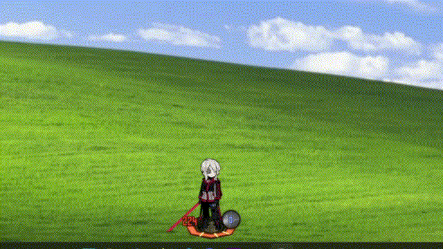
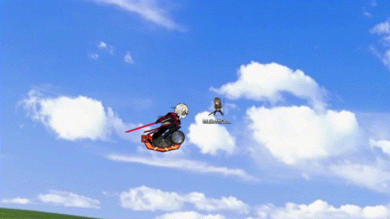

# Smoll Sinners

Small project for myself to have little Limbus Company sinners running around in my desktop. You can select sinners alongside their identities to drag and drop into your desktop, they will run around and clash with your desktop icons, moving them if they win the clash (Don't worry, they go back to the original place *for now*).

*Dragging sinners with your mouse*



*Fighting random icons in your desktop*



## Using it

The sinners live on one monitor, and the app has an icon in the Windows tray with:

- **Settings…**: the team screen, made to look like the game's formation screen. Drag a sinner's card onto the desktop to bring them out, click one of their identities to change what they're wearing, and drop a sinner back on the panel to send them home (the last one out always stays). One of each sinner at a time, like in the game.
- **Force clash**: every free sinner picks a fight with an icon right away.
- **Bring them back**: everyone drops back in from the top of the screen.
- **Monitor**: which monitor they live on.
- **Show icon boxes**: outlines every desktop icon (for debugging).
- **Quit**

Sinners can be picked up with the mouse and thrown. Clashes play out like in the game: coin flips, the game's skill animations and effects, and HP and Sanity on the bar under their feet, with staggers and panics. When the desktop is covered (a maximized or fullscreen window), they go to sleep and use next to no CPU until it shows again.

## "Tech-Stack"

- Using Godot to run the whole simulation of sinners clashing, moving, effects, etc.
  - All of it is written in GDScript: the sinners, clashes, UI and the particle effects player.
- Using C# to interact with the windows API, being able to move icons around.
  - It also reads where the icons are (through Explorer), lets clicks go through the overlay to the desktop, checks how much of the desktop is covered (for the sleep), and remembers every moved icon so it can go back home even after a crash.

## How to run

Just install Godot 4.7.2 Mono and open the project with it.

It also needs:

- **Windows**: the C# side talks to Explorer and the Windows API directly.
- **The .NET 8 SDK**: Godot Mono compiles the C# with it.

## Running Godot headless-ly

From a terminal, without the editor. Use Godot's `_console` exe (e.g. `Godot_v4.7.2-stable_mono_win64_console.exe`, written `godot` below) so the log shows up in the terminal:

```sh
dotnet build smollSinner.sln          # compile the C#
godot --headless --path . --import    # import assets and register script classes
godot --path .                        # run the sinners
```

The import step is needed after a fresh clone, and after adding assets or scripts with a new `class_name`. The sinners themselves can't run headless: they draw on a transparent window over the desktop.

## Debug flags

Flags go after a `--`:

```sh
godot --path . -- --screen 2 --fake-icons
```

The most useful ones:

- `--screen N`: start on this monitor (0 is the first).
- `--fake-icons`: made-up desktop icons, so nothing real moves.
- `--identity <path>`: only this identity out, e.g. `faust/10201_Base`.
- `--clash-test`: clash again and again as soon as the first sinner is free.

The full list is at the top of [scripts/app/launch_options.gd](scripts/app/launch_options.gd).

## Where the art comes from

Everything in `assets/limbus/` was exported from my own Limbus Company install.

## Saved files

In `%APPDATA%\Godot\app_userdata\smollSinner\`:

- `settings.cfg`: the team out on the desktop and the monitor they're on.
- `moved_icons.json`: where every moved icon started, so icons are put back on the next start if the app crashes mid-clash.

### TODO

- Match skill icons + names, in case anything is miss-matching.
- Match the clash to the game, they're quite small still graphically (and likely values).
- Probably more... Faust can't remember.

## Disclaimer

Non-commercial fan project. Limbus Company, its characters and all the game assets in this repo belong to Project Moon. (Probably my soul as well at this point).
